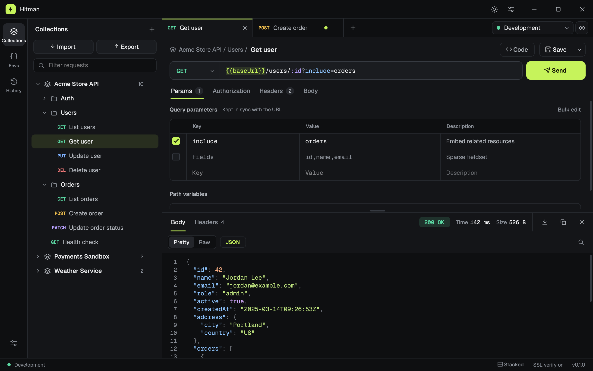
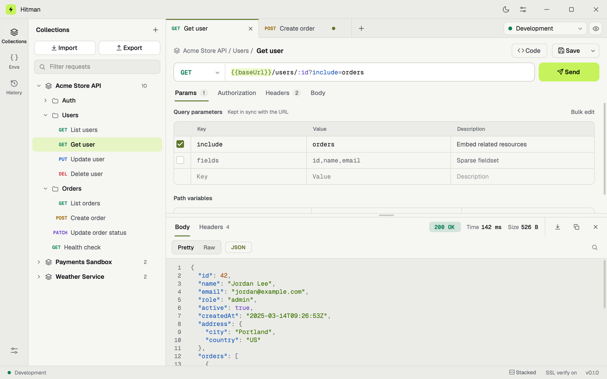
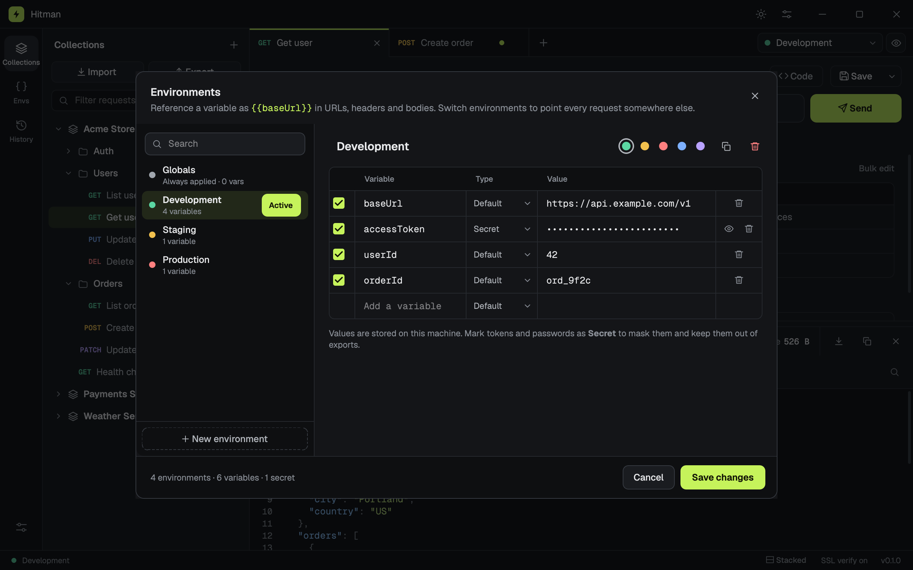
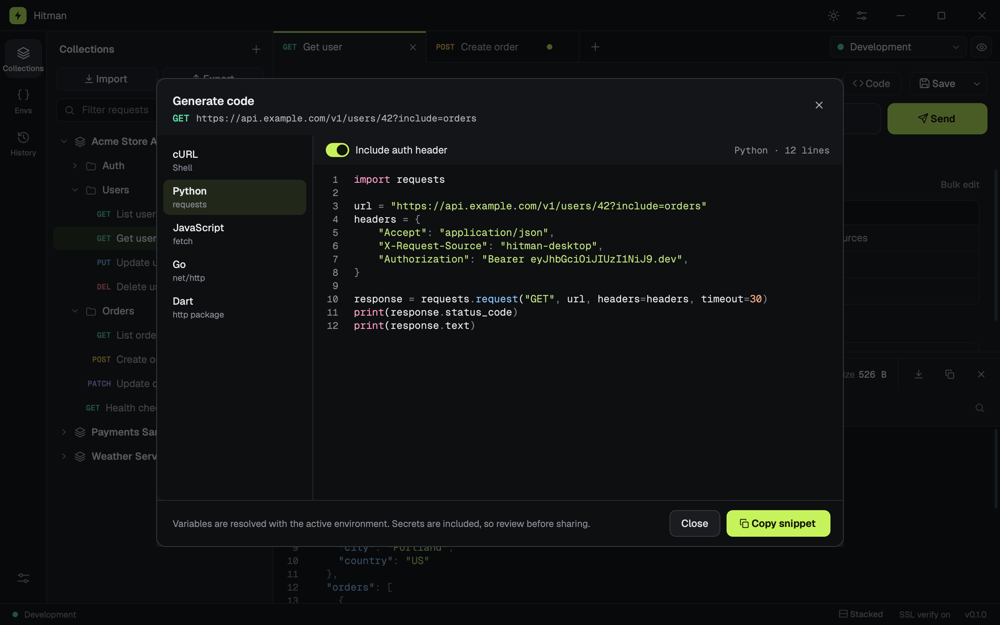

<p align="center">
  
</p>

<h1 align="center">Hitman</h1>

<p align="center">
  <b>A fast, lightweight API client for your desktop.</b><br>
  No account. No cloud. No bloat. Just send requests.
</p>

<p align="center">
  <a href="https://github.com/lioTauhid/Hitman/releases/latest"></a>
  
  <a href="LICENSE"></a>
</p>

<p align="center">
  
</p>

- **Small and quick:** a 32 MB download that opens in about a second.
- **No sign-in, ever:** install it and start sending requests.
- **Private:** everything stays in one file on your computer, with no tracking.
- **Free and open source**, for macOS, Windows and Linux.

## Download

Get the latest version from the **[Releases page](https://github.com/lioTauhid/Hitman/releases/latest)**:

| Your computer | File |
| --- | --- |
| Mac with Apple silicon (macOS 14+) | `Hitman-<version>-macos-arm64.zip` |
| Mac with Intel (macOS 14+) | `Hitman-<version>-macos-x64.zip` |
| Windows 10 / 11 | `Hitman-<version>-windows-x64.zip` |
| Linux (64-bit) | `Hitman-<version>-linux-x64.tar.gz` |

## Install

**macOS:** unzip and drag **Hitman** to **Applications**. On first launch, macOS warns that it can't
verify the app. Go to **System Settings → Privacy & Security** and click **Open Anyway**.

**Windows:** extract the zip and run **Hitman.exe** (keep it next to the `_internal` folder). If Windows
shows *"Windows protected your PC"*, click **More info → Run anyway**.

**Linux:** extract and run:

```bash
tar -xzf Hitman-*-linux-x64.tar.gz && ./Hitman/Hitman
```

You only see the security warnings once, because the app isn't signed with a paid certificate.

## Features

- **Requests:** all common methods, query params synced with the URL, headers, and JSON, XML, text,
  form or **file upload** bodies
- **Auth:** Bearer token, Basic auth and API key, set per request or once per collection
- **Environments:** use `{{variables}}` anywhere and switch between Development, Production and so on;
  secrets are masked
- **Collections and history:** folders, tabs and a full history of what you've sent
- **Responses:** formatted and highlighted JSON/XML, headers, search, copy and save
- **Import:** Postman collections, OpenAPI 3 and cURL (paste a cURL command straight into the URL bar)
- **Export and code:** export to Hitman or Postman JSON, or generate cURL, Python, JavaScript, Go and
  Dart snippets
- **Comfort:** dark and light themes, keyboard shortcuts, and tabs restored on launch

<p align="center">
  
  &nbsp;
  
</p>

## Generate code

Click **Code** to get the current request as **cURL**, **Python** (requests), **JavaScript** (fetch),
**Go** or **Dart**, with your variables already filled in. Copy it with one click.

<p align="center">
  
</p>

## Hitman vs Postman

| | Hitman | Postman |
| --- | --- | --- |
| Account required | ❌ Never | ✅ For collections, environments and sync |
| Your data | On your computer | Synced to Postman's cloud |
| Download size | **~32 MB** | ~124–149 MB |
| Installed size | **~82 MB** | ~390 MB |
| Built with | Native Qt | Electron (bundled browser) |
| Collections, environments, history | ✅ | ✅ |
| Import Postman collections, OpenAPI, cURL | ✅ | ✅ |
| Code generation | 5 languages | Many languages |
| Test scripts, runners, mock servers | ❌ | ✅ |
| Team collaboration | ❌ | ✅ |

**Hitman** is for fast, private, everyday API testing. **Postman** is for teams that need scripting,
automation and collaboration.

## Keyboard shortcuts

On macOS use **⌘** where this says Ctrl.

| Send | New tab | Save | Close tab | Search | Generate code |
| --- | --- | --- | --- | --- | --- |
| Ctrl+Enter | Ctrl+N | Ctrl+S | Ctrl+W | Ctrl+K | Ctrl+Alt+C |

See every shortcut with **Ctrl+/**.

## Your data

Everything (collections, environments, history and settings) is saved in one file, `hitman.db`:

| System | Folder |
| --- | --- |
| macOS | `~/Library/Application Support/Hitman` |
| Windows | `%APPDATA%\Hitman` |
| Linux | `~/.local/share/hitman` |

Open it from **Settings → About → Open data folder**, and copy `hitman.db` to back up or move your work.
Hitman sends nothing anywhere except the requests you make. To update, replace the app; your data is kept.

## Troubleshooting

- **SSL certificate error** (common with local servers): turn off **Settings → Requests → Verify SSL
  certificates**.
- **Linux: "could not load the Qt platform plugin xcb":** install `libxcb-cursor0` (Debian/Ubuntu) or
  `xcb-util-cursor` (Fedora, Arch).
- **Something else?** [Open an issue](https://github.com/lioTauhid/Hitman/issues).

## Build from source

You'll need Python 3.10 or newer and GNU make. make is included with macOS (Xcode command line tools)
and Linux. On Windows, use Git Bash, or install it with `choco install make` or `scoop install make`.

```bash
git clone https://github.com/lioTauhid/Hitman.git
cd Hitman
make run
```

The first `make run` creates a virtual environment, installs everything and starts the app. On Linux,
you may first need `sudo apt install python3-venv libxcb-cursor0 libegl1`.

| Command | What it does |
| --- | --- |
| `make run` | Start the app (sets everything up on first use) |
| `make test` | Run the test suite |
| `make lint` | Check the code with pyflakes |
| `make check` | Lint, then test |
| `make build` | Build the standalone app and a release archive into `dist/` |
| `make clean` | Remove build output and caches |
| `make distclean` | Also remove the virtual environment |

`make build` packages Hitman with PyInstaller for the system you run it on, leaving out the parts of Qt
the app doesn't use. It produces the app plus a ready-to-upload release archive:

| OS | App | Release archive |
| --- | --- | --- |
| macOS | `dist/Hitman.app` | `Hitman-<version>-macos-<arch>.zip` |
| Windows | `dist/Hitman/Hitman.exe` | `Hitman-<version>-windows-x64.zip` |
| Linux | `dist/Hitman/Hitman` | `Hitman-<version>-linux-x64.tar.gz` |

PyInstaller doesn't cross-compile, so build each platform on that platform.

Without make:

```bash
python3 -m venv .venv
source .venv/bin/activate        # Windows: .venv\Scripts\activate
pip install -e ".[dev]"
python -m hitman
```

Set `HITMAN_HOME` to a folder to run Hitman with a separate data file, which is handy when testing.

### Project layout

```
hitman/
  core/        Domain logic with no UI: models, URLs and variables, HTTP (requests),
               cURL parsing, code generation, import and export
  storage/     SQLite database and repositories (the only code that writes SQL)
  services/    Workspace state, open tabs, background request runner
  ui/          The PySide6 (Qt) interface
    widgets/   Reusable widgets: code editor, key/value table, file picker, tabs, popovers
    sidebar/   Collections, environments and history panels
    request/   Tab strip, URL bar, request sections
    response/  Response viewer
    dialogs/   Save, collection, import, export, environments, code and settings dialogs
    theme.py   Design tokens and the style sheet (dark and light)
    native.py  Small OS integrations (macOS title bar, Windows taskbar identity)
  assets/      Bundled Geist fonts
scripts/       build.py and hitman.spec: the standalone app build
tests/         Unit tests and offscreen UI tests
docs/          Screenshots used in this README
```

## Contributing

Bug reports, ideas and pull requests are welcome.

1. Fork the repository and create a branch for your change.
2. Run `make check` so linting and tests pass. Add tests for new behavior.
3. Open a pull request describing what changed and why.

For bugs, please include your operating system and Hitman version (shown in the bottom-right corner of
the window).

## License

[LGPL-2.1](LICENSE). Built with [Qt / PySide6](https://doc.qt.io/qtforpython-6/),
[Requests](https://requests.readthedocs.io/) and [PyYAML](https://pyyaml.org/). The interface uses the
[Geist](https://github.com/vercel/geist-font) and Geist Mono fonts, licensed under the SIL Open Font
License 1.1 (see [`hitman/assets/fonts`](hitman/assets/fonts/README.md)).
